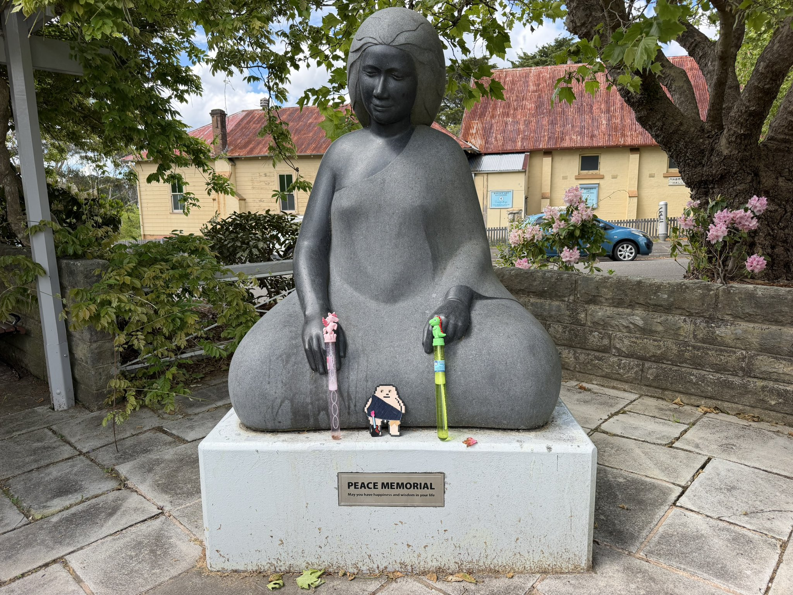

# Calming Your Nervous System

<kbd></kbd>  

> PEACE MEMORIAL  
>  
> May you have happiness and wisdom in your life  
>  
> https://x.com/BokkyPooBah/status/2114198016823529865  

Please enjoy and share the link https://github.com/bokkypoobah/TheBokkyBible/blob/main/docs/0000_CalmingYourNervousSystem.md  

Grok chat link https://x.com/i/grok/share/c2hhcmQtMw_9fe140ec-f841-4de1-9796-fb7e7d46f5d9  

X post https://x.com/BokkyPooBah/status/2122687868628083030  

---

# Calming Your Nervous System

Calming the nervous system is the first practical step toward clearer perception and ordinary presence. Many traditions point to the same foundation under different names: being still, returning to the breath, or Dhikr. When the system is no longer dominated by survival responses, the field around you becomes easier to notice and the next steps become simpler. Life is beautiful when the fears projected by oneself and by others are understood and managed.

## Why this matters

Most people learn early to scan outward for safety, permission, and validation. School routines of raising a hand before a bodily function, rejection for being “too much,” and the constant need for approval train the system to submit to an external higher power. Over time this creates a habit of expecting validation from others who are themselves carrying unresolved regulation issues. Seeking that validation becomes a conduit that lets other people’s fears enter the inner world.

Fight, flight, freeze, and fawn responses are real physiological patterns. They are useful in genuine threat and costly when they become the default. People-pleaser scripts are one common early strategy for creating a felt sense of safety in uncertain environments. Later, more direct body-based routes can replace them.

Long-term residence in these defensive states is associated with elevated cortisol. Some people notice corresponding patterns in skin (eczema and other irritations) and gut (unstable stomach, runny tummies, and later intolerances such as gluten or dairy). These are multifactorial; the personal observation recorded here is that gut symptoms have become less frequent alongside increased nervous-system calming.

Most people, including oneself, are fumbling in the dark and projecting their issues onto the external world. Forgiving oneself and others greatly lightens the load, on the recognition that everyone is learning on their own path.

## Core practices

Different doors work for different people. Formal meditation settles many. Others find the same settling through play, rhythm, or simple movement.

- **Playful imagination leading to flow.** For some, imagination itself is the most reliable route into calm.
- **Simple rhythmic action.** Periodic foot-banging on the ground in a park (visual movement plus soft vibration) can regulate both self and people nearby. The louder version is simple djembe or djembe-techno beats. Many spiritual groups use drum circles for the same reason: shared rhythm settles the system without requiring formal technique.
- **Ordinary outdoor movement.** Slow walks around trees and water, especially at night when the system is unsettled, restore baseline. A yo-yo or any simple rhythmic object can serve as a portable version of the same thing. Days spent cycling alone have also served as extended settling time.
- **Public play that is also private regulation.** Longer-lasting bubbles used to meet the wider public (mostly positive or neutral, occasionally negative) simultaneously seed the field and settle the person doing the seeding. Deliberate use of colours or objects that mark one as an anomaly (for example, pink bubble wands and speakers when pink is not the expected colour) can be part of the same practice.
- **Listening to the felt sense.** Many have been taught not to listen to themselves. Reversing that teaching is foundational. (See the 12:41 note linked below.)
- **Breathing.** Many sources emphasise a good breathing technique. It is a widely recommended tool even when it is not the primary personal method.
- **Protective distance.** Staying away from toxic dynamics has been a practical necessity at times. Concrete methods have included cycling alone for days and taking personal holidays for longer stretches. With the later understanding that these environments are largely created by the projections of others, the same settings trigger far less.

## Experimental observation

One way to identify anxiety and gain more control is to run deliberate experiments that raise it, then observe the body’s reactions in real time.

Examples:
- Drive a little under the speed limit and notice the irritation of drivers behind who want to overtake.
- Wear totally outlandish clothes down the street and into the supermarket.
- Use colours or objects that make one an anomaly in public (such as the pink gear noted above).

These journeys initially produce anxiety that is then slowly overcome through continued practice. Responses from others vary: many appreciate the authenticity, a larger number remain indifferent, and some feel threatened. Comfort can develop with the threatened reactions once they are recognised as primarily the other person’s fear rather than something that must be carried.

Projection of both fears and love onto the people we exchange with is ordinary. When someone tells you to limit yourself, it is frequently a projection of their own limitations rather than an accurate reading of you. Recognising this reduces the need to take every external signal as regulatory truth.

## History of changes

- 2026-11-17 (Opera House day): Initial collection of notes drawn from lived experience, YouTube angels, and ordinary practice. Tagged the 12:41 Mary Magdalene channelled message (“You’ve Been Taught Not to Listen to Yourself”) as directly relevant. First draft created. Later the same day: experimental anxiety runs, anomaly practice with pink gear, notes on skin/gut patterns, protective distance (cycling and holidays), and forgiveness as a load-lightener added.

Further updates will link back to the dated daily entries in which they arise.

 

---

<table style="border: 0;">
  <tr style="border: 0;">
    <td valign="top" style="border: 0;"></td>
    <td valign="top" style="border: 0;"></td>
  </tr>
</table>
