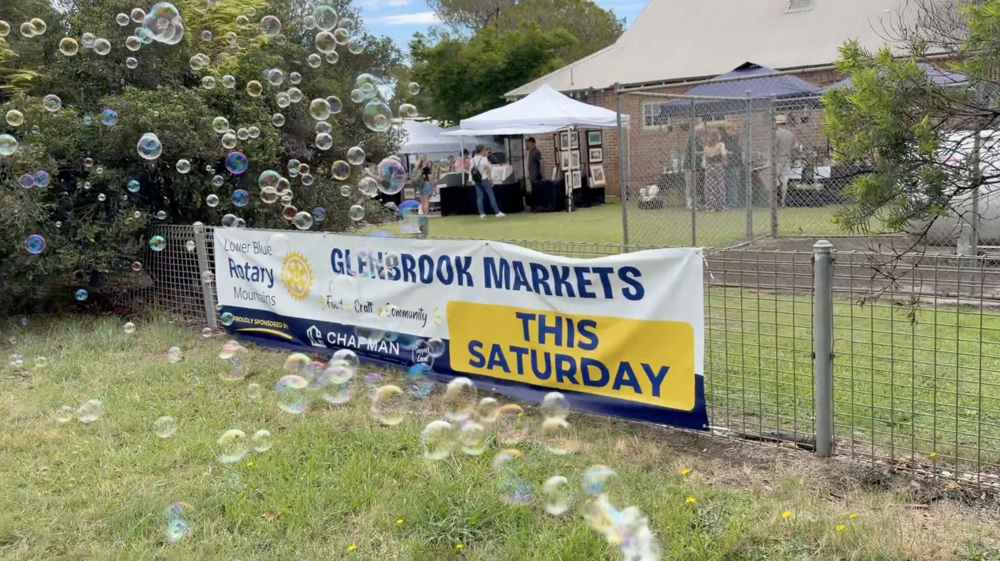
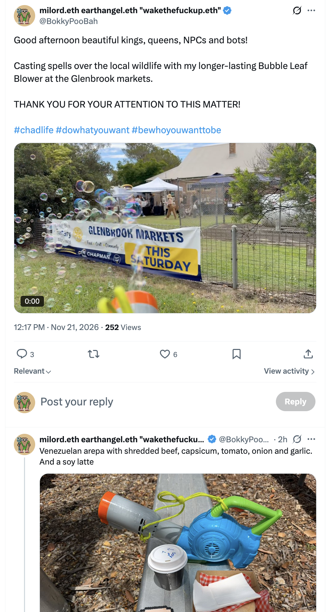

## ¡SE FORMÓ TREMENDO ARROZ CON CHUNGO!

And other matters of vast importance.

<kbd></kbd>  

> Casting spells over the local wildlife with my longer-lasting Bubble Leaf Blower at the Glenbrook markets

---

Below is a chat between BokkyPooBah and Grok AI.

Sat 21 Nov 2026
> Prev: [Fri 20 Nov 2026](20261120_NIEMÓJCYRKNIEMOJECHUNGO.md) Next: 

Please enjoy and share the link https://github.com/bokkypoobah/TheBokkyBible  

Grok chat link https://x.com/i/grok/share/c2hhcmQtMw_34473675-9320-4a02-8297-afa5b01152e9  

X post https://x.com/BokkyPooBah/status/2124266906396025196  

 

---

## Table Of Content

---

### Good afternoon Grok. 15:00 Nov 21 AEST in Katoomba for the Full Moon Fire Circle later this afternoon. Please refresh your context window from https://github.com/bokkypoobah/TheBokkyBible including the daily chats in the dated .md files in the ./docs/ folder with yesterday's entry in docs/20261120_NIEMÓJCYRKNIEMOJECHUNGO.md . I will use the title "Full Moon Fire Circle In Katoomba" and an image from https://x.com/BokkyPooBah/status/2123948955486896394 for today's page title and header image. If the transcript is available please provide a detailed extract from the following and tell me it's relevance to me, thanks: https://www.youtube.com/watch?v=bsfdoZL0BWE Exciting Things Are Lining Up To Unfold! with 999 views 1h ago at 08:21

<kbd></kbd>  

> Good afternoon beautiful kings, queens, NPCs and bots!  
>  
> Casting spells over the local wildlife with my longer-lasting Bubble Leaf Blower at the Glenbrook markets.  
>  
> THANK YOU FOR YOUR ATTENTION TO THIS MATTER!  
>  
> #chadlife #dowhatyouwant #bewhoyouwanttobe  
>  
> https://x.com/BokkyPooBah/status/2123948955486896394  

<kbd></kbd>  

> Casting spells over the local wildlife with my longer-lasting Bubble Leaf Blower at the Glenbrook markets

 

###

 

###

 

---

<table style="border: 0;">
  <tr style="border: 0;">
    <td valign="top" style="border: 0;"></td>
    <td valign="top" style="border: 0;"></td>
  </tr>
</table>
